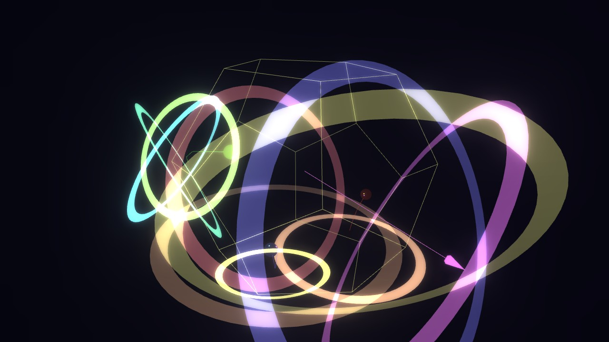
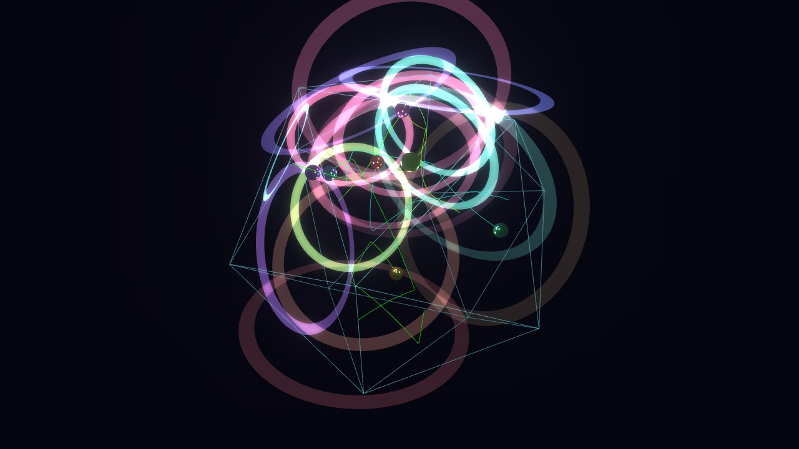
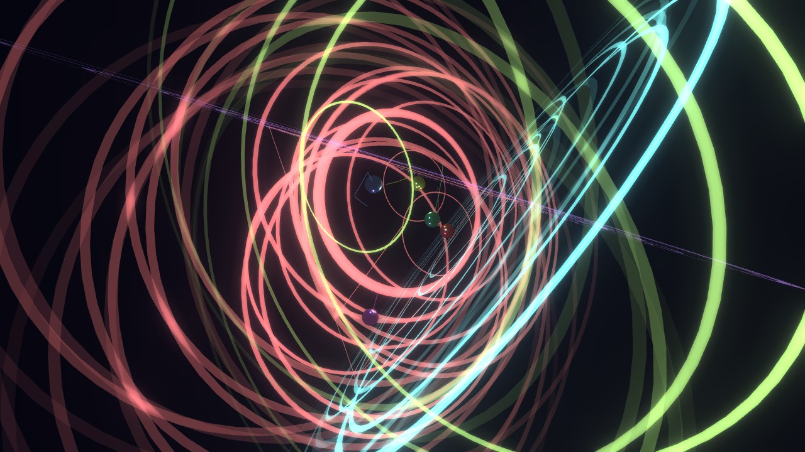
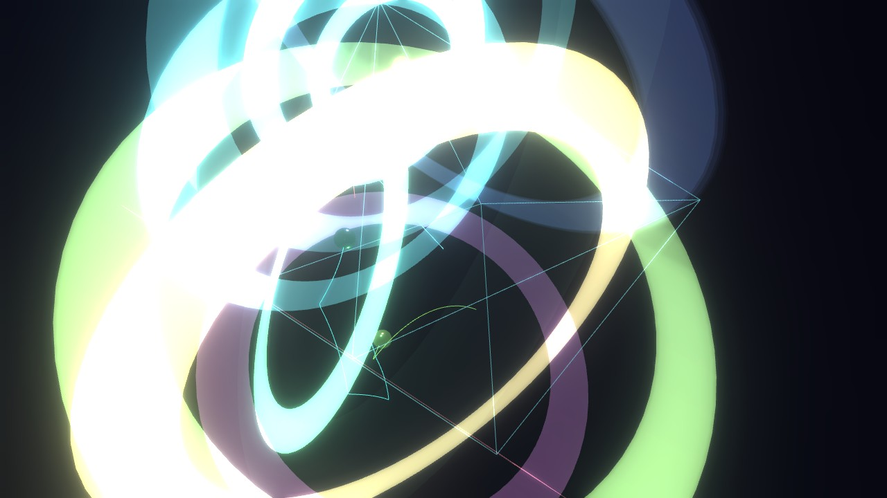

# Platonic Chimes — public assets

Screenshots and GIFs for **Platonic Chimes**, a physics-driven meditation bell: luminous spheres
drift and collide inside the five Platonic solids, and every strike rings a note.

**Play it in your browser: https://synapticon.itch.io/platonics**

This repository holds only the images used on that page.

| | |
|---|---|
|  |  |
|  |  |
